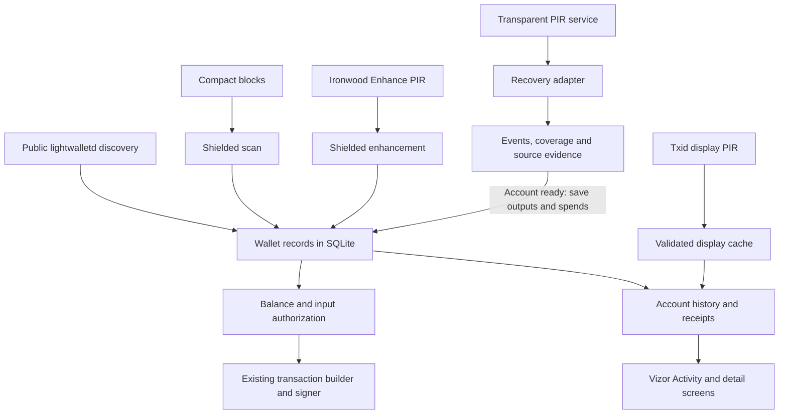

# Transparent PIR wallet integration

When Vizor synchronizes, it finds money received by the wallet, checks where
that money has been spent, and builds the balance and transaction history the
user sees. Private information retrieval (PIR) lets it recover transparent
activity without telling the lookup service which addresses or transactions it
is interested in.

These jobs finish at different times. The wallet can show a correct balance
while a receipt still lacks a recipient or memo. It can also know about a
received output without being ready to spend it: unchecked history could
contain a later spend. The architecture keeps those distinctions visible.

## 1. Design architecture

Transparent and shielded funds live in the same wallet database and use the
same transaction-building and signing machinery. Transparent PIR changes how
the wallet learns about confirmed transparent activity. The wallet saves what
it recovered, checks that enough history is present, and then makes those
outputs and spends available to its existing balance and payment code.

Four logical jobs feed the wallet:

| Job | What it learns | Effect on the wallet |
| --- | --- | --- |
| Shielded compact-block scanning | Notes the account can decrypt and spends of its notes | Discovers owned shielded funds and their movement |
| Shielded enhancement | Supported memos, outgoing notes, fee and transaction-shape information through Ironwood Enhance PIR | Adds payload details and evidence needed to interpret shielded activity |
| Transparent discovery | Receives and spends involving watched transparent addresses, through public lightwalletd requests or private script-history PIR | Establishes transparent outputs, spend links, and discovery progress |
| Transparent receipt enhancement | Display facts for an already known transaction, through txid display PIR or public raw-transaction retrieval | Fills in receipt details without granting private financial authority |

The user's privacy setting selects public or private transparent discovery.
Private recovery first saves its findings separately from usable wallet funds.
This is the **candidate** stage. Once the account is ready, **activation** makes
its recovered outputs and spends part of ordinary wallet state in one database
transaction. Later recovery saves its findings and the resulting wallet changes
together.

The discovery paths join effects by transaction ID in either arrival order,
preserving each pool's ownership evidence. Separate status work observes known
transactions; confirmed script history does not discover pending sends.

## 2. Key API boundaries

Wallet-libraries owns durable wallet facts and the decision to authorize funds.
Vizor owns the user setting, endpoints, scheduling, cancellation, network route,
and presentation. The protocol client owns how filters, directories, pages, and
private queries are encoded and retrieved.

| Boundary | Responsibility | Principal interface |
| --- | --- | --- |
| Protocol client → recovery adapter | Retrieve script histories and publication information within finite bounds | wallet-pir's `FilterSource` and `ShardTransport` |
| Vizor → recovery adapter | Supply account identity, origin, watched addresses, locally accepted chain, and routed transport; settle each pass and follow the plan's next step | `TransparentHistoryRecoveryConfig`, `WalletChain`, `HttpExchange`, `TransparentHistoryRecovery::pass`, `settle_latest`, `PassPlan` |
| Adapter → wallet store | Apply normalized events, coverage, source revisions, and continuation work | `TransparentLedgerCommit`, `TransparentLedgerWrite` |
| Wallet store → application | Read balance together with authority, coverage, and blockers; read account-specific history and its activity rows | `TransparentLedgerSnapshot`, `transaction_history_details`, `AccountActivity` |
| Receipt scheduler → wallet store | List due work, validate returned display facts, record failures, and read cached details | `TransparentDetailRead`, `TransparentDetailWrite` |
| Receipt scheduler → detail run | Order the lookups, check the display map when work waits for it, and turn each lookup's result into one wallet write | `DetailRun`, `TxidDisplayService` |
| Receipt screen → wallet store | Read one transaction's history view, transparent details, and what they establish together, in one snapshot | `transaction_receipt`, `ReceiptAttribution` |

The ledger APIs do not depend on wallet-pir's wire types. The adapter,
`zakura-pir-client`, translates protocol records, leaving publisher trust
and activation to the caller. Vizor supplies routed HTTPS, including Tor when
enabled; the adapter owns service routes and response interpretation.

A recovery pass starts with the account's state, privacy setting, watched
addresses, and the block it aims to reach. A `ChainPoint` identifies that block
by height and hash from the wallet's scan. Before saving results, the wallet
checks that this starting context still holds: deletion, a setting change,
reorganization, or activation can make an answer out of date.

Vizor trusts the configured recovery service to index the chain correctly.
The library records which publication was accepted and saves its results
together, replacing older provisional findings when appropriate. The API calls
this qualification; accepting a source does not independently verify its index.
Contradictory financial facts are rejected and the source and affected accounts
are suspended, meaning they cannot be used for private spending.

The recovery cache marks a batch handled only after every wallet write succeeds.
Each write briefly takes the database lock; network requests do not. Following
interruption, replay keeps saved results without duplicating them. Activation
checks readiness again when it saves the account's activation.

Input queries, proposal consumption, and final transaction storage enforce
financial eligibility below the UI. An earlier balance or preview cannot
authorize a send whose evidence has become stale.

## 3. Data model

The wallet stores account ownership, addresses, blocks, transactions,
transparent outputs and their spend links, shielded notes and spends, and known
sent outputs. A transaction can have raw bytes, locally retained construction
details, or only the facts recovered about it. Missing raw bytes do not mean
the transaction is absent from history.

Recovery adds evidence alongside these records:

| Evidence group | What it stores and why |
| --- | --- |
| Policy (`tpir_meta`) | Applied public/private mode, monotonic policy generation, and required reader version |
| Address windows | Existing owned addresses plus isolated candidate derivation windows; each watched address requires history from the account birthday |
| Receive and spend events | A receive identifies a transaction and output index; a spend identifies its transaction/input and the previous output it consumes |
| Revisions and observations | Which source and exact publication revision supplied each event, its replacement order, and mined placement |
| Coverage and pending pages | Checked height intervals for watched addresses, accepted endpoints, and retrieval that must resume |
| Activation, source trust, and recovery suspension | Whether recovered funds are active, which publications are accepted, and which sources/accounts cannot be used |
| Output/spend origins | Whether an ordinary wallet record is supported by public observation, local construction, private recovery, or several of them |
| Transaction metadata | Source-bound whole fee, complete transparent input count, and presence of shielded components |
| Receipt work and display cache | `transparent_detail_work`, `transparent_tx_display`, and its output rows; stored separately from financial evidence |

Re-mining changes placement, not event identity. Several publications can
observe one event, and several origins can support one wallet record. Removing
one origin preserves independent local/public evidence and other pools' effects.

Coverage is also distinct from events. A checked interval with no activity is
useful evidence; an empty table without coverage proves nothing. Suppose the
wallet recovered a 3 ZEC output at height 120 and checked history only through
150. A spend at 160 can still be missing. The displayed recovered amount is
neither an authorized balance nor necessarily a lower bound on the true one.

`TransparentLedgerSnapshot` reads amounts, authority, coverage, and blockers
together. Current authorized, last-known, and unverified amounts are distinct.
Regular and coinbase outputs retain confirmation, maturity, reservation, and
lock rules. Unavailable is not zero.

Each account also has a **companion cache**, under `{wallet-db}.tpir`, that
remembers downloaded data, where retrieval stopped, and publications already
seen. It is tied to the account, service, and data format. Only one process can
use a companion at a time. It is excluded from iOS backup and removed when its
account or binding becomes obsolete. Losing this cache causes more retrieval,
without erasing saved wallet facts or making an old publication new again.

Recent publication data changes as blocks arrive; older ranges are sealed.
The cache tracks these versions so a delayed server response cannot silently
replace newer findings. Announced changes to historical range boundaries can
preserve accepted history. Conflicting versions or unexplained rewrites stop
recovery. Sealed data still needs adjustment after a chain reorganization.

Rewinds clip invalid placements and coverage alongside chain state. Earlier
birthdays or larger address windows require more coverage. The database records
a required reader version; readers that enforce it refuse unsupported state.
An older application that predates that check cannot be assumed to honor it.

## 4. Discovery

### Finding accounts and addresses

A recovery-phrase import checks the first transparent address of additional
accounts 1–20 for history from the chosen birthday. Under public policy this
uses lightwalletd. When public probing is withheld under private queries, Vizor
checks the candidates through transparent PIR, including if the policy changes
during public probing. Accounts already found are retained.

Private import discovery downloads all applicable filters, matches locally,
and privately confirms matches, so a false positive alone offers no account.
The temporary pass opens no wallet/companion and saves no financial evidence.
It uses the publication's chain view to propose accounts; financial recovery
later checks the wallet's accepted chain. Incomplete discovery produces a
retryable error rather than a shorter list.

This is a bounded discovery rule, not a search over every derivation path. An
account with activity only outside the checked first address or birthday range
may not be found automatically.

An account watches supported external, internal/change, ephemeral, and standalone
receivers. Activity near a window's end expands it, with candidate expansion
isolated until activation. New addresses require their historical coverage;
recovery repeats until the window stabilizes or reaches a limit.

### Recovering transparent history privately

A **script** is the locking condition of a transparent output. The publisher
indexes both receives to a script and spends of outputs locked to it. A
**shard** covers a consecutive block range and has a public activity filter,
private script directory, and private event pages.

The recovery pass proceeds as follows:

1. Capture the watch set and locally accepted target. Validate the service's
   network, starting block, supported data format, and publication history.
2. Download applicable filters from the birthday's range through the target
   and match watched scripts locally. Shards wholly below the birthday are
   skipped. Each filter summarizes whether a script may have activity in that
   range; the match is checked on the wallet.
3. For matching shards, privately retrieve directory rows and required pages.
   Inline histories and paginated histories produce the same wallet events.
4. Preserve receives, spends, coverage, and continuation work. A spend whose
   receive is not yet available remains unresolved rather than inventing its
   value. Negative results count as coverage only within the supported profile.
5. Recheck context and save results. Expand the address window when necessary,
   then repeat. Data ahead of the wallet's scan does not advance its target;
   data behind it cannot establish a balance at the latest block.
6. Make the recovered funds active once every required address/range is checked,
   retrieval is finished, and all spends have known inputs. The findings must
   come from accepted sources and agree with existing wallet evidence.

The publisher's private script profile supports scripts up to 40 bytes.
Unsupported scripts or ranges cannot be treated as checked absence. Exact
coverage is relative to the supported watched set and its recovery bounds.

The library runs this loop for each account. Its pass driver makes one
pass over Vizor's routed exchange, retrying once with the same cache when the
publication set changed, and reports an unreachable service as an outage. It
then saves a ready batch through Vizor's write gate, and a pass plan decides
what follows from the pass, its settlement and the re-read watch set: pass
again to continue a budget, cover a grown window or changed addresses; wait for
a lagging or busy service; hold an account whose publication contradicts the
cache or whose replaced revisions need trusted reconciliation; skip it for this
run, also when the write gate stopped its settlement because the account's time
ran out; or stop the run, when private recovery is not enabled or the wallet's
policy changed during the run (for example, private queries were turned off),
since no further private pass may run until the next sync reads the policy
again. Vizor keeps the time budgets, how long a hold lasts, which accounts to
visit, the trust decision, cancellation and activation.

Private recovery follows foreground sync, then refreshes balances and Activity.
Vizor visits the selected account first and rotates others. Retrieval has time
and resource limits so one account cannot consume an unbounded amount of work.
Stops and restarts retain saved progress.

An outage ends the run. If published data lags behind the chain, transparent
spending waits for recovery to catch up. A refused input check says which: an
`AuthorityRefusal::Pending` refusal names accounts whose sound, unspent inputs
only await coverage of the chain tip: their only blockers are incomplete
coverage and a local chain behind the tip, so a retry after recovery catches up
may succeed. Any other blocker (open pages, unresolved spends, recovery suspension, an
account not yet active) is `Refused(NotAdmitted)`, and like every `Refused`
reason (a spent, immature or unknown input, among others) needs more than
waiting. Repeated stalls or unexplained
disagreements with saved wallet facts pause an account for an hour before retry;
recovery suspension survives restart. Other ready accounts and eligible shielded-funded
operations continue. Ledger hardware accounts pause transparent recovery
because the account birthday cannot cover their earlier history.

### Public discovery

Public discovery combines UTXO refresh, address history, and payload/spend
retrieval. UTXO responses alone do not establish historical spends. Output
storage queues missing payloads; progress advances after successful storage.

For known external and internal/change addresses, the first successful UTXO
lookup starts at genesis. Subsequent queries use stored progress and a lookback;
known internal addresses have a 20-block grouped refresh schedule. Ephemeral
addresses retain their ZIP 320 schedule and spend/expiry handling. A wallet
rewind invalidates public receive-cache completion before chain truncation.
These checkpoints and legacy observations do not certify private coverage,
whose required start is the account birthday.

## 5. Interplay with the shielded ledger and enhancement

Account history joins receipts and spends by transaction ID, with completeness
for every supported pool. One side of a mixed transaction cannot establish the
whole movement. Later discoveries refine history without duplicating effects.

The wallet keeps these quantities separate:

| Quantity | Meaning |
| --- | --- |
| Account movement | Owned value received minus owned value spent, across pools; completeness is explicit |
| Aggregate payment | Amount sent outside the selected account; exact, partial, or unknown |
| Whole-transaction fee | Total fee established by transaction evidence, independent of who paid it |
| Account fee | Fee applicable to this account: known, unattributed (the whole fee is exact but the account's share is not established), unknown, or not applicable |
| Activity | The rows a transaction shows for the account, their amounts and the outputs each counts; the wallet labels, prices and groups them |
| Payment-detail completeness | Whether recipients, payment amounts, and memos are accounted for |
| Chain status | Mining, confirmation, expiry, or conflict; independent of receipt completeness |

For a complete transparent-only spend with every input owned, exact payment is
owned inputs minus owned outputs minus the whole fee. Distinct input identities
and complete input count rule out shared funding. Mixed transactions also need
shielded effects; transparent debit alone is not external payment.

Locally constructed transactions retain their known intent and sent outputs.
Fresh restoration reconstructs what the viewing keys, chain, and indexes can
establish. `Reconstructed` describes accounted-for effects; `Provisional` means
later discovery can still change the interpretation. `NetReconstructed` records
a settled net movement without asserting who paid the fee or what payment was
made. For example, a restored transparent-to-shielded self-transfer can have
final owned effects while hidden self-balanced participation by another party
prevents full attribution.

Ironwood Enhance PIR supplies supported payload details, outgoing notes, and
transaction-shape assertions. Its transparent-output flag helps classify
activity but does not establish recipients or output ownership. Decrypting a
memo does not authenticate every publisher-supplied shape or fee assertion.
When private enhancement cannot provide transparent payload details, the wallet
retains the known activity and a private-detail obligation instead of fetching
the transaction publicly.

Shielded spend discovery requires keys that can identify the account's spent
notes. An account imported with only incoming viewing capability can receive
without establishing complete spending history.

For certain shielded-funded transactions without raw bytes, the library also
provides an Activity-only outgoing estimate: owned shielded inputs minus owned
shielded return minus the whole fee. It requires complete shielded effects,
known fee, an Enhance assertion of transparent outputs, and no known co-funding
or recorded send that supersedes the inference. It assumes this account funded
the payment unless evidence identifies another contributor. It can include an
owned transparent destination; it is neither canonical recipient attribution
nor a fee-share determination.

Each history entry carries `AccountActivity`, the rows private recovery
reconstructs, derived from the same facts and the account's outputs in the
transaction, never from display facts. The rules are checked in order:

| Activity | When |
| --- | --- |
| `InferredPayment` | A reconstructed transparent-only payment the account alone funded, with no visible output it sent |
| `FeeOnly` | A recovered self-transfer: zero exact payment, debit equal to the whole fee and the account's, no visible output it sent |
| `HiddenFundingStep` / `InferredOutgoing` | The Activity-only outgoing value, net of the account's own internal and ephemeral transparent outputs; zero with no other transparent receipt is a funding step with no row |
| `MovementDebit` | A provisional debit with no visible output it sent: the debit less an attributed fee |
| `Outputs` | The visible sent and received outputs, with an unlinked owned output counted as sent only in a recovered self-transfer |
| `Unknown` | None of the above |

Shieldings, Orchard-to-Ironwood migrations, labels, the fee each row shows, and
grouping across transactions remain the wallet's.

### Transparent receipt enhancement

Private recovery or mixed enhancement queues durable receipt work for mined
transactions with no raw bytes or usable display cache. There is one obligation
per transaction, shared across screens. It lives separately from payload work,
so a display outage cannot hold financial recovery open.

Txid display PIR looks up a known transaction and mined height. Its fixed
113-byte record contains the whole fee, input/output counts, shielded-component
flag, first address-shaped input, and outputs 0 and 1. P2PKH and P2SH scripts
have address representations. Nonstandard scripts, additional source scripts,
outputs after the second, and shared/mixed funding are reported as omissions.
The first source address is not proof of a person, wallet identity, or sole
funder. No transparent inputs means shielded funding, except for coinbase.

Display facts must agree with known outputs, spends, counts, fees, coinbase, and
shielded evidence. Checks reject provable contradictions without assuming full
knowledge. Later evidence can invalidate the cache and queue another lookup.

The private display cache changes neither balances nor library history
classification, activity, or completeness. `transaction_receipt` reads the
history view and the detail view in one snapshot and returns their
`ReceiptAttribution`, a display-level conclusion that is never stored or fed
back into the history:

- The rows account for the movement when every transparent output is listed,
  no shared or mixed funding is reported, and the account's net movement equals
  minus its fee (attributed, or whole when it spent and its share is not) and the
  outputs it does not own, or, without such a fee, the outputs it owns. Other
  funders can offset an unseen payment without breaking that equality, so shared
  or mixed funding blocks every conclusion below.
- With such a fee and accounted rows, the only output the account does not own
  is a send's recipient; with none, its own address when its outputs have one.
  It completes a send whose records name no recipient once the effects are
  settled, the transaction mined, and every owned transparent output's key scope
  known.
- The source of a receipt is the stored raw transaction's reading, completed by
  display facts' shielded source or the first address-shaped input the account
  does not own. It names no person, wallet, or sole funder.
- A received row whose outputs are all transparent, from a known source, with
  accounted rows and settled effects, is complete.

Public raw-transaction storage instead goes through ordinary transaction
ingestion and can add wallet facts.

Opening a receipt shows cached details immediately and prioritizes missing
details for the next bounded lookup run: the wallet lists a preferred receipt
ahead of other work however old it is, but only once its lookup is due.
Failures keep the receipt pending, unavailable, or explicitly not covered.
Retries are spaced out; work waiting for new publication data periodically
checks for updates instead of repeating the same lookup continuously, and a
check that fails counts too. Replies that fail on content (not in the table,
malformed, or contradicting the wallet) share one schedule, and after the third
at one mined height the lookup stops and the receipt reads as given up
(`TransparentDisplayView::GaveUp`): show it as unavailable, but stop polling it
and do not prioritize it;
refusals, outages and failures of anything but the private reply itself (such
as the display map) do not count, nor does anything under public authority. Re-mining makes the lookup eligible again, and
old responses cannot overwrite newer state. Closing a receipt does not stop
financial recovery.

The adapter's `DetailRun` carries this protocol for one run, so an application
keeps only transport, scheduling, cancellation, and its write lock:

1. `DetailRun::plan` lists the due lookups under the display map the
   `TxidDisplayService` holds, preferred receipts first. The run's mode and
   policy generation come from that listing; the caller checks them against
   the policy it captured before any lookup.
2. When nothing is due but lookups wait for a changed map and their re-check
   time has passed, the only step is `RefreshMap`. The check is recorded before
   the map is fetched, and `relist` lists again only when the map changed and
   the policy did not.
3. Each `Lookup` runs with no wallet lock held. `record` turns its result into
   one write: display facts to validate and store, a deferral naming the map
   the lookup used, or, under public transport only, the raw transaction. A
   lookup cancelled for any reason the application does not name, its time
   budget included, counts as an unavailable attempt and backs off, so one slow
   lookup cannot take every run; only a lookup the application reports as
   cancelled because it is exiting is not an attempt and writes nothing.
4. `DetailWrite::apply` stores or defers under the caller's write lock and hands
   a raw transaction back: the application stores it through ordinary
   transaction ingestion, re-checking its policy in the same wallet transaction.
   Stores and deferrals both carry the listing's policy generation, so the first
   write after a policy change fails as stale and changes nothing; ending the run
   there leaves at most the one lookup in flight made under the old policy.

## 6. How transactions work, case by case

Amounts are illustrative. Ownership means the selected account's ownership;
different addresses need not mean different wallets, and accounts remain distinct.

### Shielding to owned shielded funds

Alice spends a 3 ZEC transparent output into her shielded account, paying a
0.0002 ZEC fee. Transparent recovery finds the spend; shielded scanning finds
the 2.9998 ZEC owned receipt. The combined movement is −0.0002 ZEC, not a 3 ZEC
payment to someone else. Her transparent balance falls and shielded balance
rises. A shielding proposal requires current transparent authority for its
inputs.

Local records establish intent and fee. Restoration needs both sides settled;
a missing shielded receipt must not turn a self-transfer into an external
payment. Net reconstruction can establish movement while attribution and a
full shielding classification remain incomplete.

### Unshielding to an owned or external transparent address

For an owned destination, scanning finds Alice's shielded spend/change and
transparent discovery finds her output. Joining them avoids presenting the
gross receipt as income. Validated facts with no transparent input establish a
shielded source. Restored classification still needs settled effects and
sufficient attribution.

For an external destination, Alice's script history contains no Bob output.
Her shielded debit remains visible; local/outgoing records or txid display facts
add recipient details. Activity can infer an outgoing amount while recipient
or account fee remains unknown. Display does not discover her shielded spend.

A send funded entirely by eligible shielded notes can proceed while transparent
recovery is incomplete. If it creates an owned transparent output, spending
that output later needs transparent authority. Existing same-proposal chained
outputs use their local construction and reservation rules.

### Transparent spend, change, and several recipients

Alice spends 3 ZEC, receives 1 ZEC change, and pays a 0.0002 ZEC fee. With
complete coverage, all inputs owned, and no shielded components, the external
payment is 1.9998 ZEC. Her account movement is −2 ZEC. Change is an owned
receipt, not a second external payment.

Input identities are deduplicated and must account for every input before
inferring payment. Several recipients allow an exact aggregate with incomplete
breakdown: display PIR shows only two outputs, explicitly omitting any third.

Local records preserve payee details. A restored receipt names one payee when
shown outputs and fee account for settled movement; it does not invent a single
recipient from several payees.

### Transparent receive from outside the account

Bob pays Alice 1 ZEC without spending any Alice-owned funds. Discovery records
her output and accepted placement, and normal confirmation/maturity rules
determine availability. Bob's transaction fee is not charged to Alice.

Display shows the first address-shaped input with source omissions, not Bob's
wallet/contact identity. A shielded-funded receive has a shielded source.
Coinbase follows maturity rules. Missing source detail does not erase the
receive or its mining status.

### Own-account and cross-account transfers

A same-account transfer records input and output; only the fee leaves when
there is no external payment. Restored interpretation uses ownership, complete
effects, and fee evidence instead of presenting gross self-receive as income.

If Alice moves value from account A to account B, A sees the outgoing side and
B sees a receipt. Wallet-wide ownership does not turn B's receipt into A's
change or charge B with A's fee. Reading each account's side separately avoids
double counting when the application combines them.

### The same seed used in another wallet

A second wallet using the same seed creates activity discoverable through
watched scripts and shielded keys. Its operation records are absent, so owned
effects can be reconstructed without original intent or grouping.

Birthday, account probes, and address windows still bound discovery. A
pre-birthday output's later spend can remain unresolved and block authority;
fully spent activity beyond supported gaps can remain undiscovered. A
pre-birthday legacy output can also block activation through a discrepancy.

### Mixed pools and shared funding

Alice spends a 2 ZEC transparent output, receives 0.7 ZEC into her own shielded
account, pays Bob 1.2998 ZEC, and pays a 0.0002 ZEC fee. Her owned movement is
−1.3 ZEC. The external payment is 1.2998 ZEC; subtracting only the fee from the
transparent input would incorrectly include her own shielded receipt. The
wallet joins both pools and preserves incomplete classification when either
owned side may still be missing.

Shared funding is separate: Alice, Bob, or several accounts contribute inputs.
Each account's effects can be final without an established payment or fee
share. Whole fee and output addresses do not resolve this. Display flags name
multiple scripts and mixed funding; wallet input evidence decides ownership.
Unsupported attribution remains unknown.

### TEX and other multi-step operations

A TEX address requires payments funded entirely by transparent inputs. A
shielded-funded payment uses a funding transaction to an owned ephemeral
transparent address and a second transaction spending it to the TEX destination.
These are two transactions,
each with its own fee, placement, and possible failure. The intermediate owned
output must not be counted as an unrelated external payment or new income.

Local proposal/outbox records link the legs and reservations. Restoration
recovers individual effects; grouping and combined operation fee need supporting
evidence. The first leg does not prove the second mined. Spend/expiry rules
determine when leftover intermediate funds can be reused.

Swap and gift-card records similarly carry application intent that generic
chain recovery cannot invent. Losing those records can leave correct underlying
transactions with a more generic presentation.

### Pending transactions and incomplete evidence

Locally created pending sends keep their construction records and reservations.
Status and accepted-chain observations determine mining, expiry, or conflict;
confirmed transparent PIR does not manufacture mempool history. Reorgs can
remove placement and re-arm receipt work while retaining independent local
evidence.

Interrupted pages, publication lag, unresolved spends, or incomplete pool
discovery leave known facts intact but do not justify a final payment or a
current private transparent balance. Missing recipients do not hide a known
debit. Missing fees do not become zero. Receipt enrichment does not resolve a
financial coverage gap.

## 7. Privacy boundary: toggling public and private

**Private queries** is saved for the installation and shared by transparent
recovery, enhancement, and status lookups. It selects private transparent
recovery on mainnet. The wallet database also remembers the applied mode, so a
restart or another connection cannot accidentally weaken it. In the API,
`PrivateRequired` means public transparent discovery is forbidden even while
private recovery is incomplete.

### Turning private queries on

Vizor blocks new public transparent lookups, waits for already authorized
requests to be sent, and saves the private mode. Each ordinary public request
checks permission immediately before sending. A mode-change counter prevents
older work and responses from being used under the new setting. Requests
already sent cannot be recalled.

This coordination covers one wallet within the app process. Another process
changing its mode is outside that guard; saved-state checks still reject old
work but cannot recall requests. Startup, background, import/preview, and native
entry points use the same privacy rules. An unreadable startup preference does
not grant permission for public transparent lookups.

Until an account's history is current, transparent spending and shielding pause.
The last-known amount remains informational. Accounts recover separately, and
eligible shielded-funded operations continue. New blocks can pause transparent
spending again until scanning and recovery catch up.

Failures leave work incomplete, never selecting public fallback. Automatic
private work sends no plaintext transparent address, script, previous-output
identifier, or transaction ID to lightwalletd. Chain work that does not name
wallet addresses or transactions, and authorized broadcasting, remain separate.

### Turning private queries off

Vizor discloses address and transaction-interest exposure. A persisted explicit
opt-out lets startup finish interrupted transitions. Failed policy lowering
keeps transparent queries private and offers a retry.

Once public mode is saved, private recovery stops and outstanding work follows
the new setting. Previously withheld transactions can be fetched publicly.
Resumed address and transaction queries can link privately learned information
to the wallet.

`forget_private_recovery` (zakura-pir-client, feature `sqlite`) deletes
every companion and only then runs `forget_transparent_ledger` through the
application's `WriteGate`. A companion records which revisions the wallet
holds; one that outlived the facts would make a later private run skip them, so
a companion still in use (`ForgetError::CompanionBusy`) or a declined gate
leaves the facts in place. So does any policy change after the companions were
deleted (`ForgetError::PolicyChanged`), even private and back to public: the
forget's wallet transaction checks the policy generation read before the
deletion, because a private pass in between could have created a companion. It
refuses a wallet not public on the handle and durably before deleting anything.
The forget removes private-only spends, outputs, events, coverage, and
source-bound facts. Public discovery rebuilds from its own observations.
Independently supported records, shielded state, and reservations survive.
Locked/referenced outputs may remain without counting value; unsupported
transaction rows are removed.

Source trust, publication ordering, and recovery suspension are retained: returning to
private mode cannot accept an older publication or clear a suspended source.
A failed cache removal or forget is retried on public sync startup. Lowering
policy and forgetting evidence are separate steps; failure of the cleanup does
not make the already public policy private again.

### Loading one receipt publicly

A receipt can offer **Load publicly** when the private source does not cover
the transaction or the displayed output list omits outputs after the second.
The confirmation explains that lightwalletd learns interest in that one txid,
and the IP address when Tor is off. This explicit action is allowed regardless
of transparent policy; it does not turn off private queries for the wallet.

Ordinary ingestion stores raw bytes and supersedes display facts. All
transparent outputs become available, but shielded recipients, intent, or fee
shares can still be unknown. The raw view reads available unlocking scripts for
sender information without recursive parent lookups. Refreshes/failures never
invoke this public action automatically.

### What remains visible and trusted

| Observer | Information available from these operations |
| --- | --- |
| Public lightwalletd in public mode | Queried addresses/scripts or transaction identifiers, timing, and network origin unless hidden by the route |
| Transparent history service | Recovery range and matched shard requests, query counts/sizes and timing; PIR hides the selected rows, not these patterns |
| Txid display service | Tier, shard/range, hash bucket, and timing; a lookup uses two row queries regardless of the transaction's shape or whether it is found |
| PIR origins without Tor | The client's network origin in addition to request patterns |
| Chain observers and broadcast peers | Published transparent outputs and the previous outputs spent, plus the transaction's public structure |

Tor hides network origin from the service, not the contents of authorized public
queries. Range/timing can link import discovery and recovery. PIR does not
shield transparent on-chain activity or hide every access pattern.

The indexer is trusted for complete, accurate filters, amounts, spends, fees,
and coinbase classification. Digests, revisions, anchors, and contradiction
checks reject inconsistencies, not every self-consistent fabrication or
omission. PIR hides selection; it does not prove correct indexing.

## Appendix: behavior reference

Keeping local records, reopening the same database, and restoring from a
recovery phrase give the wallet different information. Where discovery is
complete, the financial facts agree. Recipients, original intent, and grouping
can be less detailed after a restore.

| Case | Behavior to preserve |
| --- | --- |
| Transparent-only send | Exact aggregate under complete ownership/coverage and fee evidence; no invented recipients |
| Several inputs/recipients | Count each input once, show the correct aggregate, and identify omitted outputs |
| Transparent receive | Correct owned amount and chain status; honest source address and omissions |
| Retained local transaction | Preserve construction facts; restored details reflect available evidence |
| Shared funding | Correct per-account effects without fabricated payment or fee shares |
| Self/cross-account transfer | Respect account scope and avoid counting gross self-receives as income |
| Owned shielding/unshielding | Join both pools before interpreting the transfer; preserve uncertain attribution |
| External unshielding | Preserve the shielded debit; recover external outputs through separate detail evidence |
| Mixed-pool transaction | Separate owned pool movement from external payment and incomplete breakdown |
| TEX/multi-step operation | Preserve individual legs; group only with supporting operation evidence |
| Swap/gift card | Preserve retained intent without inventing it from generic chain data |
| Pending/expired/conflicted | Use local records, status lookups, and chain evidence independently of confirmed-history discovery |
| Incomplete coverage | Preserve known facts without claiming final payments or current spendability |
