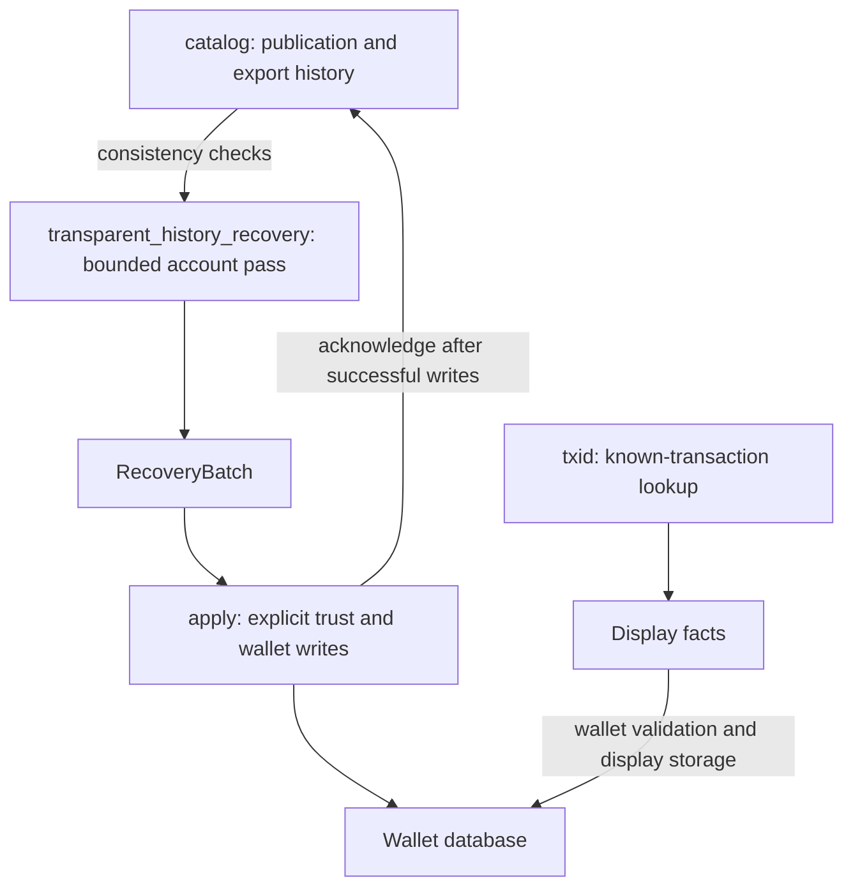

# Transparent PIR adapter

`zakura-pir-transparent` connects the transparent private information retrieval
(PIR) clients to wallet-libraries. It recovers an account's transparent history
as normalized wallet evidence and retrieves display details for transactions
the wallet already knows.

The central boundary is between **retrieval** and **financial authority**.
A successful private query establishes what the configured publisher reports.
The wallet independently checks the account, chain, policy, and stored facts;
it owns source qualification, account activation, balances, and spending.
The application chooses which publisher to trust and when to run each job.
For the complete user-facing architecture, see the
[wallet integration guide](../../docs/transparent-pir-wallet-integration.md).

## Abstractions and module responsibilities

The public facade is [src/lib.rs](src/lib.rs). Implementation modules are
private; callers use the types and traits re-exported by the crate.

| Module | What it abstracts | Boundary it presents |
| --- | --- | --- |
| [`catalog`](src/catalog.rs) | Publication identity and the durable history of revisions seen or exported | Determines whether publication evidence can be handed to the wallet consistently |
| [`transparent_history_recovery`](src/transparent_history_recovery.rs) | One account's bounded retrieval and conversion into wallet evidence | `TransparentHistoryRecovery::open`; each pass builds an opaque `RecoveryBatch` |
| [`pass`](src/pass.rs) | One pass as a wallet runs it: fresh transports, a publication-change retry, and the ready batch held for settlement | `TransparentHistoryRecovery::pass` returns a `PassReport` or a `PassError` |
| [`plan`](src/plan.rs) | Settling the held batch, and what an account does after each pass | `settle_latest`, and `PassPlan::next` returning a `Step` |
| [`txid`](src/txid.rs) | Private display lookup for an already known transaction | `TxidDisplayService` returns lookup results; `display_facts` converts found entries to wallet display facts |
| [`apply`](src/apply.rs) | Ordered SQLite wallet writes followed by companion acknowledgment | Explicit `Trust`, optional `WriteGate`, and a result describing the committed work |
| [`companion`](src/companion.rs) | Account cache files and their exclusive ownership | `CompanionDir` opens, retains, and removes companions under operating-system locks |
| [`http`](src/http.rs) | PIR service routes and response interpretation over caller-owned HTTP | `TransparentPirHttp` and `TxidHttp` use an `HttpExchange` |
| [`discover`](src/discover.rs) | A temporary search for activity on candidate addresses before a wallet exists | `discover_active_addresses` returns active candidate indices and progress |
| [`chain`](src/chain.rs), [`batch`](src/batch.rs), [`progress`](src/progress.rs), [`convert`](src/convert.rs), [`error`](src/error.rs) | Accepted-chain access, pass results, scheduling hints, representation conversion, and errors | Shared contracts used by the operations above |



### `catalog`: publication continuity and export history

The catalog checks whether a publication agrees with what this companion has
already seen and possibly handed to the wallet. It hides the bookkeeping needed
to recognize a newer tail, a lagging replica, contradictory revisions, and a
declared re-cut of historical ranges.

A shard is a published block range. Its revision identifies the particular
contents being served. Recent ranges can change as blocks arrive; older ranges
are sealed. A re-cut republishes ranges under different boundaries and must
explicitly declare the revisions it supersedes.

The catalog derives stable identities from the account/service binding and
publication, records export intent before returning a batch, and keeps enough
history to detect conflicting reuse of a revision. It classifies a pass as
`Ready`, `Pending`, or `Withdrawn`. These are consistency decisions, not source
trust or permission to spend. A withdrawal does not itself remove wallet facts.

| Private child module | Responsibility |
| --- | --- |
| [`identity`](src/catalog/identity.rs) | Derive companion bindings, source identities, and wallet revision identities from publication fields |
| [`layout`](src/catalog/layout.rs) | Create and validate the companion's catalog tables and supported formats |
| [`pass`](src/catalog/pass.rs) | Compare a pass's publication with recorded history, classify it, and record exports in a catalog transaction |
| [`recut`](src/catalog/recut.rs) | Check supersession declarations and remember the re-cut epoch followed by the store |
| [`exports`](src/catalog/exports.rs) | Acknowledge resolved exports and prune catalog rows that are no longer needed |
| [`store_tables`](src/catalog/store_tables.rs) | Reset or prune the reference client's tables without discarding the catalog's continuity history |

### `transparent_history_recovery`: a bounded account pass

Recovery runs a bounded pass for an account's watch set and accepted chain. It
hides reference client setup, continuation, publication checks, event conversion,
and batch construction behind `TransparentHistoryRecovery`.

Address derivation stays with the caller. The API accepts a watch set and
recovers its history during both wallet restoration and ongoing synchronization.

The caller supplies a `TransparentAddressWatchSet`, a `ChainView`, and an
`HttpExchange`, over which a pass builds the two transport interfaces,
`FilterSource` and `ShardTransport`. The watch set carries
owned addresses, required history heights, pending work, and the wallet context
under which results will be applied. `TransparentHistoryRecoveryConfig` supplies
stable bindings and finite script, shard, event-export, query, and private-byte bounds.

A pass retrieves through the reference client into the companion, then
normalizes stored receives, spends, coverage, and page work into
`TransparentLedgerCommit` values. It consults the catalog before releasing them.
The wallet writer validates those values again when they are applied; retrieval
holds no wallet write lock and does not activate accounts.

| Private child module | Responsibility |
| --- | --- |
| [`preflight`](src/transparent_history_recovery/preflight.rs) | Validate the watch set and publication bounds, network, schema, and supported filter mode before further retrieval |
| [`sync_inputs`](src/transparent_history_recovery/sync_inputs.rs) | Adapt watched scripts, the accepted chain, the history floor, the sync target, and the map retained from retrieval |
| [`publication_gate`](src/transparent_history_recovery/publication_gate.rs) | Handle changed publication identity, lagging publications, and refused sealed-history rewrites |
| [`normalize`](src/transparent_history_recovery/normalize.rs) | Turn stored facts into a batch within a catalog transaction and decide whether it can reach the wallet |
| [`commit_builder`](src/transparent_history_recovery/commit_builder.rs) | Group facts under their original revision identities and build anchored wallet commits |
| [`page_completion`](src/transparent_history_recovery/page_completion.rs) | Translate unfinished pages and complete wallet page obligations when coverage spans them |
| [`receipt`](src/transparent_history_recovery/receipt.rs) | Bind acknowledgment to the latest issued ready batch |

### `txid`: reusable display lookup and translation

Txid lookup retrieves bounded display information for a known transaction at
its mined height. It has no account-discovery or financial-recovery role.

[`service`](src/txid/service.rs) wraps the protocol client in
`TxidDisplayService`. The application keeps one service per origin for the
process's lifetime, sharing maps, manifests, setups, and native profiles across
lookups. Lookups serialize on the client; waiting and requests honor
cancellation. Map digest and last-check time can be read without waiting for an
in-flight lookup. Unsupported display formats can be checked again through a
map refresh without dropping the client's pinned chain identity.

[`display_facts`](src/txid/display_facts.rs) converts a found entry and its
publication provenance into `TransparentDisplayFacts`. It checks the requested
transaction tag, value bounds, record consistency, and map digest. The wallet's
`TransparentDetailWrite` then validates the facts against wallet evidence and
stores them. The bounded record carries a whole fee, input/output counts,
shielded-component flags, a source-address slot, and the first two outputs;
omission flags prevent treating it as a full transaction or sole-funder proof.

`deferral` maps absence, unpublished or uncovered placement, unsupported format,
and failures into durable detail-work outcomes. Cancellation is not counted as
a completed attempt. Scheduling, database writes, and receipt presentation
remain with the caller and wallet store.

## Data model and ownership

There are two durable databases and several short-lived values. Their lifetimes
matter: retrieval progress can survive a restart without granting the wallet
permission to use the recovered funds.

| Object | Owner and lifetime | Meaning |
| --- | --- | --- |
| Wallet database | Wallet-libraries; durable | Account ownership, accepted chain, policy generation, candidate evidence, qualification, activation, balances, and display work/cache |
| Companion reference store | Reference client, managed by this adapter; durable per account/service | Retrieved events, script coverage, unfinished pages, filters, setups, and publication binding |
| Companion catalog | `catalog`; durable in the same companion file | Publication identities, revisions observed/exported, and acknowledgment bookkeeping |
| `TransparentAddressWatchSet` | Wallet reader; snapshot for a pass | The account's addresses and history requirements, target, and context needed to reject stale results |
| `RecoveryBatch` | Adapter; one pass's immutable result | Ordered commits, state, progress, retired revisions, and an opaque acknowledgment receipt |
| `TxidDisplayService` | Application; process-local per origin | Reusable protocol client and lookup caches, separate from account companions |
| `TransparentDisplayFacts` | Translated result, then wallet display cache | Receipt information and provenance, without balance or spending authority |
| `Discovery` | Temporary import result | Indices into caller-provided candidate addresses and how completely they were checked |

### Companion identity and catalog tables

A companion is bound to `TransparentHistoryRecoveryConfig::source`, `account_binding`, `origin`,
and `SCHEMA`. The origin is an identity label, not a URL the adapter dials;
the supplied transports must actually reach that origin. Use one companion per
account and binding. `CompanionDir` names files by account and origin/schema and
holds a cross-process lock until the returned `Companion` drops. Direct
`TransparentHistoryRecovery::open` does not supply that directory-level lock management.

The companion's catalog stores:

- `pir_bridge_binding`: format, account/source binding, and followed re-cut epoch.
- `pir_bridge_catalog`: revision contents and anchors, with current/exported marks.
- `pir_bridge_exports`: every revision that may have reached the wallet; retained
  so pruning working catalog rows cannot permit conflicting identity reuse.

The format is `transparent-reference-companion-v3`; the supported shard schema
is `transparent-shard-v11`. Opening a v2 companion rebuilds its catalog in place
and preserves retrieved facts. The old v1 format is refused. Resetting a
companion after a publication change preserves catalog continuity; replacing
it to get past a contradiction would erase useful history.

### Stable revisions and wallet commits

A `RecoveryRevision` separates three concepts:

| Field | Meaning |
| --- | --- |
| `source` | Hash of the companion binding, stable publication-set fields, range geometry/seal parameters, and shard start height; excludes the renumberable shard ID |
| `revision` | Hash of the manifest digest and sealed state, identifying the served contents |
| `lineage` | Publisher revision number plus one, ordering revisions within a source |

Identities are derived rather than counted locally. Reopening a companion
reproduces them. A declared re-cut preserves stored sealed facts under the
identities the wallet already holds; renumbering later shards does not by itself
change their sources.

Each wallet commit binds its events and coverage to a recovery context, a
revision, and an independently accepted block anchor. Receives identify outputs;
spends identify the previous outputs they consume. Missing receives remain
unresolved. Coverage records checked absence as well as activity. Opened and
completed page obligations carry continuation across passes.

`retired_revisions()` lists previously exported provisional revisions for which
this batch contains newer successors. These notifications do not authorize
removal. Trusted wallet settlement qualifies successors and withdraws older
provisional evidence in the same wallet transaction.

### Batch state and progress are independent

`BatchState` answers whether the batch may be applied; `Progress` answers how
far retrieval got and why it stopped. A `Ready` batch can contain useful partial
work. A `Complete` outcome does not make a withdrawn publication applicable or
activate the account.

| State | Caller behavior |
| --- | --- |
| `Ready` | Apply the ordered commits using the chosen trust mode, then acknowledge |
| `Pending` | Apply nothing; the publication or retrieval cannot yet reconcile with recorded history |
| `Withdrawn(cause)` | Apply nothing; retain the companion and wait for new work that addresses the contradiction |

Withdrawal causes distinguish revision regression, equivocation, changed sealed
content, and a range retired without an accepted declaration. A lagging replica
can be pending rather than contradictory.

| Outcome | Meaning and scheduling |
| --- | --- |
| `Complete` | All watched scripts are covered through the target; run again for new work |
| `Behind` | Publication ends below the target; coverage may reach its end; retry after a delay |
| `More` | A work budget stopped retrieval; resume from saved continuation |
| `Overloaded` | Capacity refusals exhausted the retry budget; retry after a delay |
| `Stalled` | Unknown chain blocks, unresolved spends, or bounded discovery prevent progress; new information is needed |

Prefer `RecoveryBatch::retry()` (or `PassReport::retry()`) to
`Progress::retry()`: it also treats any withdrawn batch as stalled, even when
retrieval reports complete. Read a fresh watch set when applying commits grows
an address window. `PassPlan::next` turns both into the next step.

## Execution modes

The crate provides separate operations, not a single global execution-mode
switch. Source trust, wallet privacy policy, and enabled Cargo features are
independent inputs.

| Operation | Inputs and state | Output and authority |
| --- | --- | --- |
| Import discovery | Candidate addresses, floor, transports, and `DiscoveryLimits`; fresh in-memory store | `Discovery`; activity hints for deciding which accounts to import |
| Account recovery | Watch set, accepted chain, the caller's exchange, and durable companion | `PassReport`, with a ready `RecoveryBatch` held for settlement; source-bound evidence waiting for wallet validation |
| Observed settlement | Latest ready batch and SQLite wallet, with `Trust::Observed` | Candidate evidence only; a batch with retirements is refused before any write |
| Trusted settlement | Latest ready batch and SQLite wallet, with explicit `Trust::Trusted` | Qualified evidence and reconciled provisional predecessors; requires `PrivateRequired` on the handle and durably |
| Receipt lookup | Known txid, mined height, cancellation, and shared txid service | Display result/facts; wallet validates and stores them separately |

Qualification still does not activate an account or authorize a spend.
The wallet makes those decisions through its own recovery-readiness and input
eligibility rules. This module contains no public address, txid, parent, or
previous-output lookup fallback.

### Account recovery and settlement sequence

A wallet drives an account with three calls per pass and no loop logic of its
own:

```rust,ignore
let mut plan = PassPlan::new(wallet.transparent_watch_set(account)?, PassLimits::default());
let mut step = plan.first();
while let Step::Pass | Step::Refresh | Step::Wait(_) = step {
    if let Step::Wait(wait) = step { sleep(wait) } // within the caller's budget
    let chain = WalletChain::new(&*wallet, plan.watch().target.unwrap());
    let report = companion.pass(plan.watch(), &chain, &exchange, limit, &should_stop)?;
    let settled = companion.settle_latest(wallet, trust, &mut gate);
    step = plan.next(&report, &settled, wallet.transparent_watch_set(account)?);
}
```

1. `PassPlan::new` takes a fresh wallet watch set and owns the one each pass
   uses. Build `WalletChain` or another independent `ChainView` through its
   target; the required history floor is the account birthday. Open the
   account's companion once.
2. `pass` recovers through a fresh `TransparentPirHttp` on the caller's
   exchange, so an outage never carries over. Preflight checks target
   acceptance, script limits, refusal of selective parent filters, publication
   bounds, mainnet identity, and schema. An accepted empty watch set completes
   without network requests.
3. The reference client downloads applicable filters and privately retrieves
   matching histories into the companion. Ranges wholly below the floor are
   excluded. A publication behind the target can supply partial accepted
   coverage, but cannot claim to reach the target.
4. Recovery normalizes facts under their publication identities; the catalog
   decides whether to return commits and records export intent before return.
   After `RecoveryError::PublicationChanged` the pass retries once with the same
   companion unless `should_stop` returns true. It returns a `PassReport`
   (state, progress, `retry()`, commit and retirement counts, whether the
   publication changed), which names nothing from the wallet's history, and
   holds a ready batch inside the companion: `take_latest` takes it for a
   caller that discards it or settles without `sqlite`. A `PassError` names
   only its variant: `Outage` for any failure while the transports saw one,
   otherwise `Invalid`, `Failure` or, when the change was found again or while
   stopping, `PublicationChanged`.
5. Choose observed or trusted settlement explicitly. With `sqlite`,
   `settle_latest` takes the held batch and settles it through
   `apply_and_acknowledge_gated`, returning `Ok(None)` when the pass held
   nothing. `Trust::Observed` with retired revisions is refused before the gate
   runs or the wallet is written, so a caller settles every pass.
6. `PassPlan::next` decides the next step from the report, the settlement, and
   the watch set re-read after settling. It makes no request and reads no clock.

| Pass and settlement | `Step` |
| --- | --- |
| The watch set has no target | `Done(None)` |
| `Withdrawn(cause)` | `Hold(HoldCause::Withdrawn(cause))`: a timer would read the same contradiction |
| `ApplyAction::Refresh` (a stale commit) | `Refresh`, uncounted, with the fresh watch set; `Skip` after `stale_refreshes` (3) |
| `ApplyAction::Reconcile` | `Hold(HoldCause::Unreconciled)`: only trusted settlement resolves the retirements |
| `ApplyAction::Skip`, or a ready batch nobody settled | `Skip` |
| `ApplyAction::Interrupted` | `Skip`: the gate stopped the account's settlement; the caller checks its own cancellation before the next pass |
| `ApplyAction::NotEnabled` | `Stop(StopCause::NotEnabled)` |
| `ApplyAction::PolicyChanged` | `Stop(StopCause::PolicyChanged)`: no further private pass under the policy the run captured; the next run captures it again |
| `ApplyAction::Fail` | `Fail`: report the `ApplyFailure` |
| `passes` (8) counted passes | `Done(Some(retry))` |
| `Retry::More` | `Pass`: the companion resumes |
| `Retry::After(wait)` | `Wait(wait)` |
| `Retry::Complete` or `Stalled` | `Pass` for new work (a grown window or changed addresses), else `Done(Some(retry))` |

The caller keeps what is policy: its time budgets and the cap on waits, how
long a hold lasts, the trust it states, its write gate and threads, cancellation
of requests in flight, and activation after `Done`. `take_latest`,
`apply_and_acknowledge` and `acknowledge_applied` remain for callers that bring
their own wallet writer.

Settlement writes each commit in its own wallet transaction. An outer SQL
transaction is refused, so an integrity rejection's recovery suspension cannot be
rolled back by a caller. `WriteGate::write` surrounds one wallet transaction
at a time, plus the short read transaction used to fence final acknowledgment;
it can interrupt between writes. Network retrieval takes place before this
write phase. `Ungated` runs every write without application-level coordination.

Acknowledgment commits in the companion only after every wallet write succeeds,
with policy generation checked again. The databases are not atomic together:
a crash or failure can leave a committed prefix in the wallet and an
unacknowledged batch in the companion. `ApplyFailure::stats` reports that prefix.
The next pass re-exports the work; replay preserves already applied facts.
Only the latest issued ready batch's receipt can be acknowledged.

A custom wallet writer can apply `batch.commits()` and then call
`acknowledge_applied` when there are no retirements. A batch with retirements
requires the trusted SQLite settlement helper; manual acknowledgment refuses it.
`PassPlan` holds an untrusted caller's account (`HoldCause::Unreconciled`) at
the first such batch instead of repeatedly accumulating successors it cannot
reconcile.

`forget_private_recovery` turns private recovery off once the wallet's
transparent policy is `Public` on the handle and durably: it deletes every
companion, then runs the wallet's `forget_transparent_ledger` through a
`WriteGate`. Companions go first because one that outlived the facts would make
a later private pass skip them; a companion in use or a declined gate forgets
nothing. So does any policy change after the forget began, even private and back
to public, which could have created a companion meanwhile:
`ForgetError::PolicyChanged`, checked in the forget's own wallet transaction.

### Import discovery

`discover_active_addresses` checks candidate addresses from a floor through the
publication's end using a temporary in-memory store. It downloads every
applicable filter and privately confirms matches. False positives alone never
report a candidate as active. A receive or spend at or above the floor counts,
including a spend of an output received earlier.

There is no wallet, durable companion, catalog, or independent wallet chain in
this operation. The publication supplies its own chain view because discovery
only proposes accounts. The caller imports those accounts and recovers them
against the wallet's accepted chain before using any funds. Only `Complete`
means all candidates were checked; a partial list is not a complete import.

### Receipt lookup

Reuse `TxidDisplayService` for the origin and call `lookup` with the txid in
internal byte order, its mined height, and cancellation. The `DisplayLookup` it
returns names the map that lookup used. Convert a found entry with
`display_facts`, then submit it to the wallet's detail writer. For other
results, `deferral` supplies the detail-work outcome to record with that map. Refreshing the
map can detect newly published or newly supported data. Account recovery and
receipt lookup have separate state and scheduling, so display unavailability
does not hold financial recovery open.

`DetailRun` drives one run of the wallet's txid detail work through the
service: which lookups to make (receipts the caller prefers first), when to
check the display map, and which wallet write each result makes. It records a
map check before fetching, so a failed or abandoned check is bounded too. A
lookup the caller's run budget stopped is `DetailAnswer::TimedOut`: an attempt,
deferred as `Unavailable` so it backs off (30 seconds, doubling up to an hour)
instead of staying first in every listing. A lookup stopped because the caller
is exiting is `DetailAnswer::Cancelled` and writes nothing. It holds no lock,
thread or budget; the caller looks up between steps with no wallet lock held
and applies each write under its own.

## Transport and failure contracts

The application implements `HttpExchange`: send one request to its bound
origin, enforce the request's success/error body limits, and return the reply
as received. It owns HTTPS, Tor/routing, timeouts, and cancellation. It never
retries or interprets statuses. The adapter owns routes and status translation;
the protocol clients own retry decisions. There is no built-in HTTP client in
the library's normal dependency graph.

`TransparentPirHttp::split` supplies the filter and shard interfaces for a pass.
A shard-bound 409 is a stale revision; supported capacity responses become
`Overloaded`. A 429 is never capacity, even with `retry-after`. `outage()` tells
the caller that the origin is unreachable or not serving, which `pass` reports
as `PassError::Outage`; the application stops visiting further accounts rather
than repeat an outage for each one.
`TxidHttp` supplies the display client's transport over the same exchange.

`ApplyFailure::action()` distinguishes refreshing stale context, reconciling
retirements, skipping a refused/unacknowledgeable batch, stopping disabled
recovery, reporting a wallet failure, and handling a gate interruption.
`RecoveryError::PublicationChanged` resets retrieval state while retaining the
catalog; `pass` retries once with the same companion. Pending or withdrawn results do
not justify recreating the companion to bypass continuity checks.

Log at most HTTP route templates and error variants. Recovery errors can quote
transparent history or transport details. PIR hides selected rows, while range,
request-size, timing, and network-origin information can remain visible.
Catalog consistency and accepted-chain anchors do not prove that an indexer
included every event or reported every value honestly.

## Features and validation

| Cargo feature | Exposed functionality |
| --- | --- |
| No features (default) | Recovery and display APIs are disabled |
| `wallet` | Recovery, catalog-backed companions, discovery, transports, and display lookup/translation |
| `sqlite` | Includes `wallet`; adds SQLite settlement, explicit trust, and write gates |
| `testing` | Includes `wallet`; supplies synthetic batches and a txid publication for application tests; keep out of production builds |

Run the relevant development configuration from the repository root:

```sh
python3 scripts/dev.py test --config transparent-pir
python3 scripts/dev.py test --config transparent-pir-sqlite
python3 scripts/dev.py test --config transparent-pir-testing
```

The [in-process recovery tests](tests/private_recovery.rs) use real PIR and
record requests while exercising recovery, settlement, activation, reorgs,
publication changes, and re-cuts, driving every pass through `pass`,
`settle_latest` and `PassPlan` over a loopback `HttpExchange`.
[Discovery tests](tests/private_discovery.rs)
exercise temporary import probing. The child-module tests cover normalization,
catalog continuity, replay, and lookup translation.

The [recover-activity example](examples/recover-activity.rs) (feature `sqlite`)
is a bounded real-HTTP harness for candidate evidence and durable reopening,
running the same driver with observed settlement over its own exchange. Its snapshot uses
independently collected chain headers and controlled public script fixtures;
it refuses qualification and activation. It establishes retrieval and
persistence, not ownership of those fixture funds or full wallet presentation.
See [the development workflow](../../docs/development.md) for build ownership
and validation configurations.
